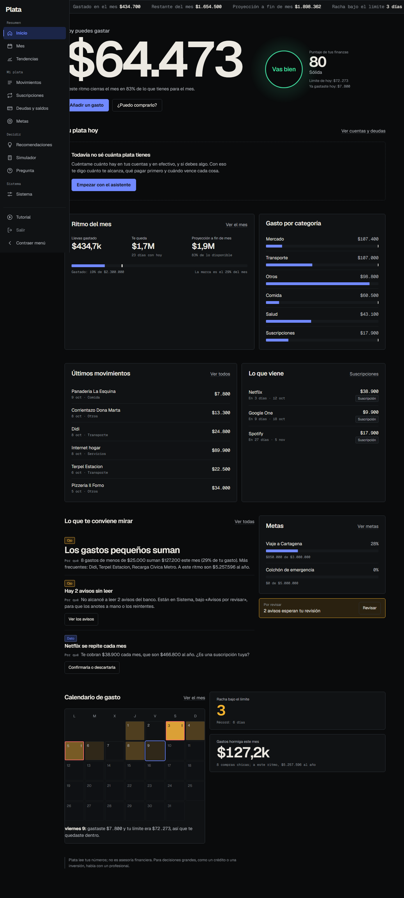

# Plata — private-first personal finance demo

Plata is a local personal-finance dashboard that turns transaction notifications into understandable budgets, trends and recommendations. Calculations are deterministic; local AI is optional and is limited to interpreting or explaining text.

This public repository runs against **synthetic demo data only**. It does not include personal transactions, credentials, database backups, Telegram configuration or private automation workflows.



## Product highlights

- Daily spending allowance based on balances, income, debt minimums and the next payday.
- Accounts, debts, budgets, goals, subscriptions and transaction review.
- Explainable recommendations and purchase simulations.
- Local SQLite storage, responsive PWA interface and optional local AI integration.
- Broad automated coverage across calculations, API routes and security rules.

## Run the demo

Requires Node.js 22 or newer.

```bash
npm install
npm run demo
npm run dev
```

Open [http://127.0.0.1:3010](http://127.0.0.1:3010). Development mode uses `data/panel-dev.db`, generated entirely from deterministic synthetic fixtures.

## Quality checks

```bash
npm test
npm run lint
npm run build
```

## Privacy and scope

- `data/`, `.env*`, database files, reports and test artifacts are ignored.
- No banking, email or Telegram credentials are needed for the demo.
- The software is educational and is not financial advice.
- The original private installation and its data are maintained separately.

## License

Source code is published for portfolio review. No license is granted for reuse, redistribution or commercial use unless the author provides written permission.

